# Career Intelligence Assistant — API (`@repo/api`)

NestJS backend application providing automated document ingestion, AI-powered parsing, pairwise fit analysis, vector semantic search, and multi-document comparative chat streaming.

---

## Architecture Overview

```mermaid
flowchart TD
    Client["Client / Web App"] -->|"1. Request presigned URL"| StorageController["Resume / Job Controller"]
    StorageController -->|"2. S3 presigned URL"| Client
    Client -->|"3. Direct binary PUT"| S3["S3-compatible Object Storage"]
    Client -->|"4. Complete upload"| CompleteController["Complete Endpoint"]
    CompleteController -->|"5. Insert Job (PENDING)"| DB[(PostgreSQL + pgvector)]

    subgraph BackgroundWorker ["Autonomous Pipeline Worker"]
        Worker["PipelineWorker (1s tick)"] -->|"pessimistic_write + skip_locked"| DB
        Worker -->|"Claim oldest PENDING job"| Worker
        Worker -->|"Download PDF bytes"| S3
        Worker -->|"Extract text"| PDFExtract["PdfExtractionService"]
        Worker -->|"Parse structured JSON"| Groq["Groq (Llama 3 / OpenAI SDK)"]
        Worker -->|"Generate 1536d vector"| Gemini["Google Gemini (gemini-embedding-001)"]
        Worker -->|"Update document status: READY"| DB
        Worker -->|"Mark job COMPLETED"| DB
    end

    Client -->|"Pairwise Fit Analysis"| AnalysisService["AnalysisService"]
    AnalysisService -->|"Structured Analysis JSON"| Groq
    AnalysisService -->|"Upsert FitAnalysis"| DB

    Client -->|"Semantic Match Search"| JobSearch["JobPostingService (pgvector <=>)"]
    JobSearch -->|"Ranked jobs by cosine distance"| DB

    Client -->|"Streaming Chat (SSE)"| ChatService["ChatService"]
    ChatService -->|"Fetch Resume + M Ordered Jobs"| DB
    ChatService -->|"Labeled prompt context"| Groq
    Groq -->|"Token stream async generator"| ChatController["ChatController (SSE)"]
    ChatController -->|"data: chunk events"| Client
```



---

## Modules Breakdown

| Module          | Directory                 | Responsibility                                                                                                                      |
| --------------- | ------------------------- | ----------------------------------------------------------------------------------------------------------------------------------- |
| **Auth**        | `src/modules/auth`        | Session-based authentication via Better Auth (`User`, `Session`, `Account`, `Verification`).                                        |
| **Storage**     | `src/modules/storage`     | S3 client wrapper (`S3Service`): presigned upload URLs, `HeadObject` byte validation, download streams.                             |
| **Pipeline**    | `src/modules/pipeline`    | Background queue and worker (`PipelineWorker`, `PipelineService`, `PdfExtractionService`). Polling with PostgreSQL row-level locks. |
| **Resume**      | `src/modules/resume`      | Resume entity lifecycle, career-oriented embedding text generation, schemas.                                                        |
| **Job Posting** | `src/modules/job-posting` | Job posting lifecycle, structured requirements schema, embedding text generator, semantic matching via `pgvector`.                  |
| **Analysis**    | `src/modules/analysis`    | Pairwise `FitAnalysis`: match scores (0–100), skill gaps, experience alignment mapping, interview prep questions.                   |
| **Chat**        | `src/modules/chat`        | Multi-document conversations (`1 Resume : M ordered Jobs`), SSE streaming endpoint, conversation persistence.                       |
| **AI**          | `src/modules/ai`          | Groq chat completions, structured JSON schema parsing, streaming generator, and Google Gemini embeddings (`EmbeddingService`).      |

---

## API Endpoints

### 1. Authentication (`/api/auth`)

- `POST /api/auth/sign-up/email`: Register a new user.
- `POST /api/auth/sign-in/email`: Log in and receive a session cookie.
- `GET /api/auth/get-session`: Retrieve the active user session.
- `POST /api/auth/sign-out`: Invalidate the session.

### 2. Resumes (`/api/resumes`)

- `GET /api/resumes`: List all resumes owned by the authenticated user.
- `POST /api/resumes`: Initiate upload (`{ fileName, contentType, fileSize }`), returns `{ id, uploadUrl }`.
- `GET /api/resumes/:id`: Poll resume status (`PENDING_UPLOAD`, `PROCESSING`, `READY`, `FAILED`), raw text, and `parsedProfile`.
- `POST /api/resumes/:id/complete`: Confirm S3 upload, verify exact byte length and content type, and enqueue a processing job.
- `DELETE /api/resumes/:id`: Delete a resume.

### 3. Job Postings (`/api/jobs`)

- `GET /api/jobs`: List all job postings.
- `POST /api/jobs`: Initiate upload (`{ fileName, contentType, fileSize }`), returns `{ id, uploadUrl }`.
- `GET /api/jobs/match?resumeId=...&limit=5`: **Semantic Search via pgvector** — returns jobs ranked by cosine similarity against the candidate resume embedding.
- `GET /api/jobs/:id`: Poll job status, raw text, and `parsedData`.
- `POST /api/jobs/:id/complete`: Confirm S3 upload and enqueue a processing job.
- `DELETE /api/jobs/:id`: Delete a job posting.

### 4. Fit Analysis (`/api/analysis`)

- `POST /api/analysis`: Trigger or re-run a pairwise fit analysis (`{ resumeId, jobPostingId }`).
- `GET /api/analysis?resumeId=...&jobPostingId=...`: Retrieve the pairwise analysis for a specific resume and job posting.
- `GET /api/analysis/resume/:resumeId`: Retrieve all fit analyses for a candidate resume, sorted by `matchScore DESC` (multi-job comparison ranking).

### 5. Chat Assistant (`/api/chat`)

- `GET /api/chat`: List active chat threads.
- `POST /api/chat`: Create a comparison thread (`{ resumeId, jobPostingIds: [id1, id2], title? }`).
- `GET /api/chat/:id`: Retrieve thread details and full chronologically ordered message history.
- `PATCH /api/chat/:id`: Update conversation job postings or title.
- `DELETE /api/chat/:id`: Delete a conversation.
- `POST /api/chat/:id/messages`: Send a message and receive a standard JSON reply.
- `POST /api/chat/:id/messages/stream`: Send a message and stream tokens via Server-Sent Events (SSE). The complete message is saved to PostgreSQL once the stream finishes.

---

## Docker & Containerization

The API can run inside Docker with PostgreSQL 16 + pgvector and MinIO.

```bash
# Start PostgreSQL (pgvector) and MinIO from root:
pnpm docker:db

# Or run full stack with Docker Compose:
pnpm docker:up
```

- When running via Docker Compose, migrations run automatically on container startup if `RUN_MIGRATIONS=true`.
- The `pgvector` and `uuid-ossp` extensions are auto-initialized via `docker/init-db.sql`.

---

## Database Migrations

TypeORM data-source configuration is located in `src/database/data-source.ts`.

```bash
# Generate a migration after entity changes
pnpm migration:generate src/database/migrations/MigrationName

# Apply pending migrations
pnpm migration:run
```

All migrations run against PostgreSQL with the `pgvector` extension enabled (`vector(1536)`).
