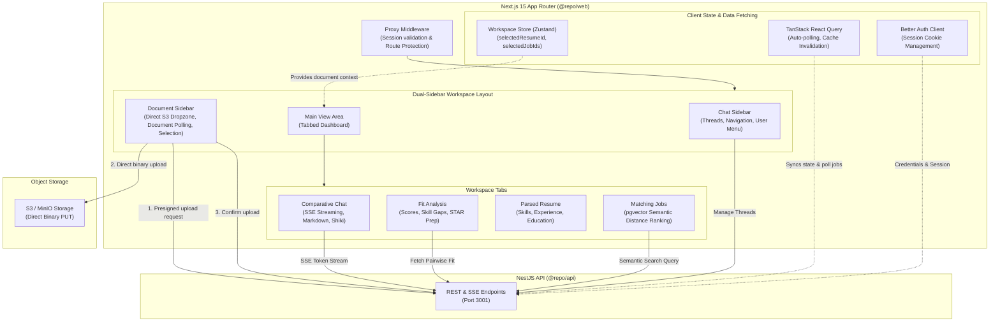

# Career Intelligence Assistant — Web Application (`@repo/web`)

Next.js 15 (App Router) frontend interface for the Career Intelligence Assistant. Features dual-sidebar navigation, direct S3 drag-and-drop document uploads, multi-tab comparative workspace, Server-Sent Events (SSE) AI streaming with syntax highlighting, and session-based authentication via Better Auth.

---

## Architecture Overview



---

## Features & Workspace Views

### 1. Dual-Sidebar Workspace

- **Left Sidebar (`ChatSidebar`)**:
  - Lists historical conversations with linked resume and job posting badges.
  - Create new multi-document conversation threads.
  - User session profile dropdown (`UserMenu`) with sign-out support.
- **Right Sidebar (`FileSidebar`)**:
  - Drag-and-drop upload zone (`Dropzone`) for resumes and job postings (PDF).
  - Background ingestion status tracker (`PENDING_UPLOAD` → `PROCESSING` → `READY` / `FAILED`) with automatic polling.
  - Document selection checkboxes to bind candidate resume and target jobs to the active workspace.
  - Document deletion with automatic cascade cache invalidation.

### 2. Workspace Tabs

- **Chat (`Chat.tsx`)**:
  - Multi-document comparative conversations across 1 resume and multiple target jobs.
  - Real-time token streaming over Server-Sent Events (`/api/chat/:id/messages/stream`).
  - Markdown rendering (`react-markdown` + `remark-gfm`) with Shiki syntax-highlighted code blocks (`highlighter.tsx`).
  - Smooth autoscroll and message animations.
- **Fit Analysis (`FitAnalysisView.tsx`)**:
  - Pairwise match score breakdown (0–100 scale).
  - Categorized skill gap visualization: matched skills, missing required skills, and missing preferred skills.
  - Experience alignment mapping table with fit levels (`HIGH`, `MEDIUM`, `LOW`).
  - Targeted technical interview questions with key talking points.
  - Behavioral interview preparation questions with STAR framework guidance.
- **Parsed Resume (`ParsedResumeView.tsx`)**:
  - Profile inspector showing candidate contact info, executive summary, categorized skills (languages, frameworks, tools, soft skills), employment history with bullet highlights, and education.
- **Matching Jobs (`JobMatchesView.tsx`)**:
  - Semantic vector search powered by `pgvector` (`<=>` cosine distance).
  - Ranked job listings with percentage similarity scores and required qualifications.

### 3. Authentication & Route Protection

- **Session Authentication**: Managed via Better Auth client (`src/lib/auth-client.ts`) with HTTP-only session cookies.
- **Protected Routes**: Handled by Next.js proxy middleware (`src/proxy.ts`), checking `better-auth.session_token` and redirecting unauthenticated traffic to `/sign-in`.
- **Auth Pages**: Card-styled `/sign-in` and `/sign-up` forms with client-side validation, error handling via Sonner toast notifications, and password visibility toggles.

---

## Directory Structure

```text
apps/web/src/
├── api/                  # API client and service endpoints (resumes, jobs, analysis, chat)
│   ├── client.ts         # Base fetch wrapper with credentials inclusion
│   ├── resumes.ts        # Resume CRUD & upload endpoints
│   ├── jobs.ts           # Job postings & semantic matching endpoints
│   ├── analysis.ts       # Pairwise fit analysis endpoints
│   └── chat.ts           # Thread creation & SSE streaming client
├── app/                  # Next.js App Router
│   ├── (auth)/           # Route group for authentication
│   │   ├── sign-in/      # Sign-in page
│   │   └── sign-up/      # Sign-up page
│   ├── (chat)/           # Route group for chat workspace
│   │   └── [[...id]]/    # Dynamic conversation route & default landing
│   ├── error.tsx         # Route error boundary
│   ├── global-error.tsx  # Root global error handler
│   ├── layout.tsx        # Root HTML layout with providers
│   ├── not-found.tsx     # 404 handler with redirection
│   └── providers.tsx     # TanStack Query & Theme/Tooltip providers
├── components/           # React workspace components
│   ├── ui/               # Reusable Shadcn UI primitives (button, tabs, sidebar, etc.)
│   ├── Chat.tsx          # Streaming chat view
│   ├── ChatSidebar.tsx   # Left conversation sidebar
│   ├── Dropzone.tsx      # S3 drag-and-drop file uploader
│   ├── FileSidebar.tsx   # Right document manager sidebar
│   ├── FitAnalysisView.tsx # Pairwise fit scoring and interview prep
│   ├── Header.tsx        # Top navigation bar
│   ├── JobMatchesView.tsx  # Semantic vector matching view
│   ├── ParsedResumeView.tsx# Candidate profile inspector
│   └── UserMenu.tsx      # User account menu & logout
├── hooks/                # Custom React hooks (useDocumentUpload, useMobile, etc.)
├── lib/                  # Utilities (auth-client, shiki highlighter, cn helper)
├── store/                # Zustand client state (workspace.ts)
└── proxy.ts              # Session proxy and route protection middleware
```

---

## Environment Variables

Create `.env.local` inside `apps/web` or set in the repository root `.env`:

| Variable | Description | Default |
| :--- | :--- | :--- |
| `NEXT_PUBLIC_API_URL` | Base URL of the NestJS backend API | `http://localhost:3001` |

---

## Development & Scripts

From the repository root or within `apps/web`:

```bash
# Start Next.js development server on port 3000
pnpm dev

# Build the production bundle
pnpm build

# Start the production Next.js server
pnpm start

# Run ESLint
pnpm lint

# Run TypeScript checks and Next.js typegen
pnpm typecheck
```

---

## Docker Deployment

`apps/web` includes a standalone multi-stage `Dockerfile` optimized for Next.js production output:

```bash
# Build standalone web container
docker build -f apps/web/Dockerfile -t career-assistant-web .

# Run with container networking
docker run -p 3000:3000 -e NEXT_PUBLIC_API_URL=http://localhost:3001 career-assistant-web
```

