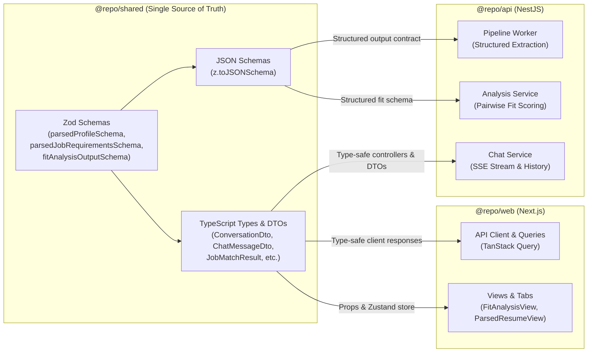

# Career Intelligence Assistant — Shared Library (`@repo/shared`)

Common TypeScript contracts, Zod validation schemas, JSON Schema definitions for LLM structured outputs, and Data Transfer Objects (DTOs) shared across `@repo/api` (NestJS) and `@repo/web` (Next.js).

---

## Overview

The `@repo/shared` package serves as the single source of truth for all domain entities, validation rules, and communication contracts in the monorepo. It ensures complete end-to-end type safety between the NestJS backend and the Next.js frontend, while supplying strict JSON Schema specifications required by Groq and OpenAI SDK for structured outputs.

---

## Contract Architecture



---

## Exports & Schema Reference

### 1. Document & Ingestion Contracts

| Export | Type | Description |
| :--- | :--- | :--- |
| `APP_NAME` | `const string` | Application branding identifier (`'Resume Assistant'`). |
| `HealthResponse` | `interface` | Backend healthcheck probe response (`{ status: 'ok', app: string }`). |
| `DocumentStatus` | `type union` | Ingestion status lifecycle: `'PENDING_UPLOAD' \| 'PROCESSING' \| 'READY' \| 'FAILED'`. |
| `FileUploadPayload` | `interface` | Payload to request S3 presigned URL (`{ fileName, contentType, fileSize }`). |
| `UploadInitiationResponse` | `interface` | Presigned URL initiation response (`{ id, uploadUrl }`). |

### 2. Resume Profile Schemas

- **`parsedProfileSchema`**: Zod schema validating candidate resumes:
  - `name`, `email`, `phone`, `summary` (`string | null`).
  - `skills`: Categorized arrays for `languages`, `frameworks`, `tools`, and `softSkills`.
  - `experience`: Array of `{ title, company, startDate, endDate, highlights }`.
  - `education`: Array of `{ institution, degree, year }`.
- **`ParsedProfile`**: Inferred TypeScript type (`z.infer<typeof parsedProfileSchema>`).
- **`jsonParsedProfileSchema`**: JSON Schema generated via `z.toJSONSchema` for LLM structured output parsing.

### 3. Job Requirements Schemas

- **`parsedJobRequirementsSchema`**: Zod schema validating extracted job descriptions:
  - `role`, `level` (`string | null`).
  - `requiredSkills`, `preferredSkills`, `responsibilities` (`string[]`).
  - `experienceYears` (`number | null`).
- **`ParsedJobRequirements`**: Inferred TypeScript type.
- **`jsonParsedJobRequirementsSchema`**: JSON Schema generated for Groq structured output extraction.

### 4. Pairwise Fit Analysis Schemas

- **`skillGapResultSchema` (`SkillGapResult`)**:
  - `matchedSkills`: Skills present in both resume and job requirements.
  - `missingRequired`: Mandatory requirements absent from the resume.
  - `missingPreferred`: Nice-to-have qualifications absent from the resume.
- **`experienceAlignmentResultSchema` (`ExperienceAlignmentResult`)**:
  - `score`: Experience alignment numeric score.
  - `strengths`: Candidate strengths specific to job duties.
  - `concerns`: Potential misalignments or experience deficits.
  - `mapping`: Detailed breakdown array of `{ jobRequirement, matchingExperience, fitLevel: 'HIGH' | 'MEDIUM' | 'LOW' }`.
- **`interviewPrepResultSchema` (`InterviewPrepResult`)**:
  - `technicalQuestions`: Targeted questions mapped to identified skill gaps, with recommended talking points.
  - `behavioralQuestions`: Questions targeting key responsibilities with structured STAR method guidance.
- **`fitAnalysisOutputSchema` (`FitAnalysisOutput`)**:
  - Aggregate schema combining `matchScore` (0–100 integer), `skillGaps`, `experienceAlignment`, and `interviewPrep`.
- **`jsonFitAnalysisOutputSchema`**: JSON Schema passed to AI model for deterministic fit analysis scoring.

### 5. Chat & Streaming DTOs

| Export | Type | Description |
| :--- | :--- | :--- |
| `CreateConversationPayload` | `interface` | Payload to initialize a thread (`{ resumeId, jobPostingIds, title? }`). |
| `SendMessagePayload` | `interface` | Body for message dispatch (`{ message }`). |
| `ConversationDto` | `interface` | Full conversation representation with linked resume and job posting IDs. |
| `ChatMessageDto` | `interface` | Individual message record with `role` (`'user' \| 'assistant' \| 'system'`). |
| `StreamChatChunk` | `interface` | Server-Sent Event (SSE) payload chunk (`{ content?: string, error?: string }`). |
| `JobMatchResult<TJob>` | `interface` | Generic wrapper for pgvector similarity match results (`{ job: TJob, similarityScore: number }`). |

---

## Usage in Monorepo

### In `@repo/api` (NestJS)

```typescript
import {
  jsonParsedProfileSchema,
  ParsedProfile,
  FitAnalysisOutput,
  jsonFitAnalysisOutputSchema,
} from '@repo/shared';

// Direct use in OpenAI / Groq structured output calls
const completion = await groq.chat.completions.create({
  model: 'llama-3.3-70b-versatile',
  messages: [...],
  response_format: {
    type: 'json_schema',
    json_schema: {
      name: 'fit_analysis',
      schema: jsonFitAnalysisOutputSchema,
    },
  },
});
```

### In `@repo/web` (Next.js)

```typescript
import type {
  ConversationDto,
  FitAnalysisOutput,
  DocumentStatus,
} from '@repo/shared';

// Type-safe props and state hooks
export function FitAnalysisView({ conversationId }: { conversationId: string }) {
  const { data } = useQuery<FitAnalysisOutput[]>({ ... });
}
```

---

## Build & Scripts

From the repository root or within `packages/shared`:

```bash
# Compile TypeScript to dist/ (commonjs + declarations)
pnpm build

# Type check without emitting files
pnpm typecheck

# Lint shared source code
pnpm lint
```

